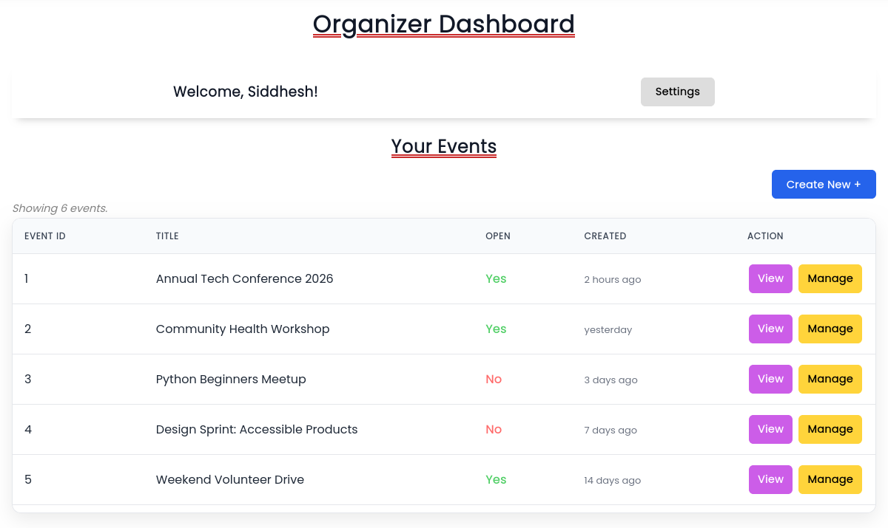
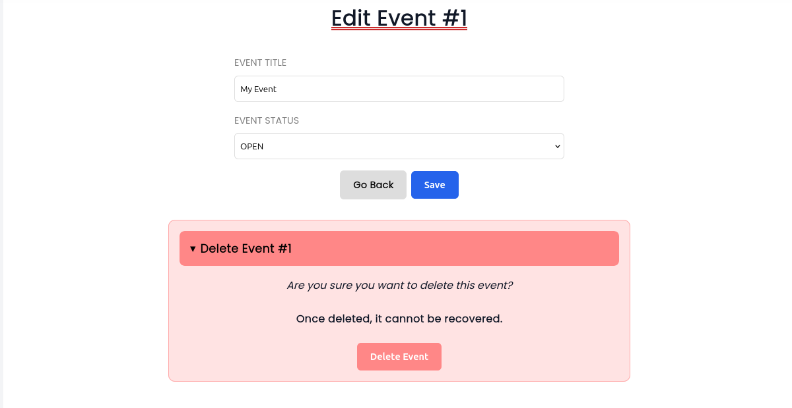
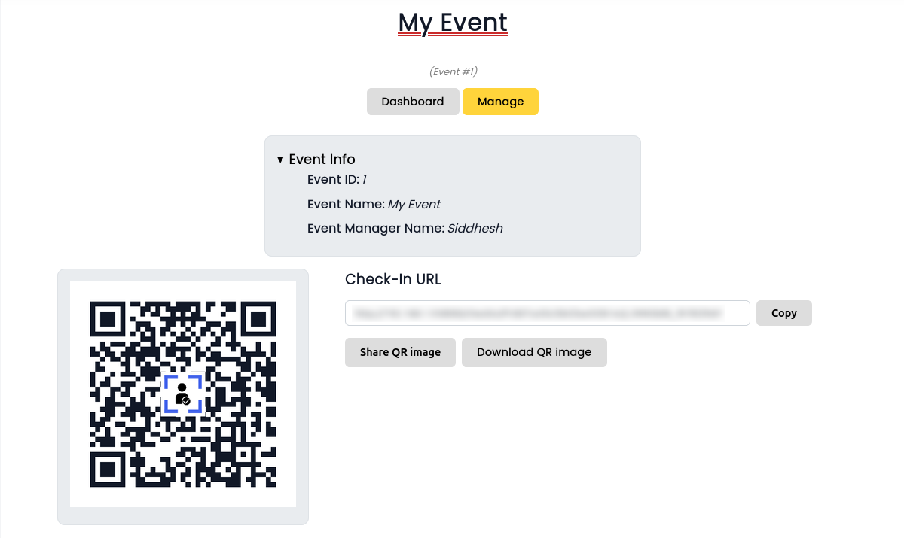
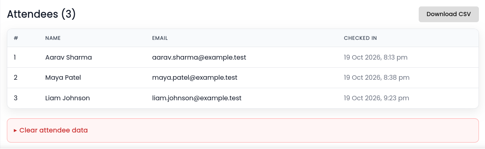
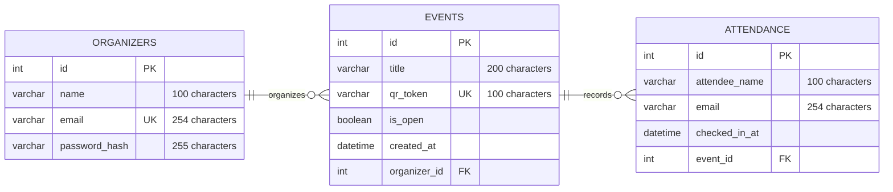

# SmartAttend

#### Video Demo: TODO

#### Description:

SmartAttend is a web-based event attendance management system that
uses **QR codes** to simplify the process of recording and managing
attendance. It is designed to help event organizers manage attendance
without relying on manually maintained paper registers or spreadsheets.

Traditional attendance-taking can be time-consuming, especially when
many people attend an event. Recording names manually can also lead to
duplicate entries and make it difficult to organize attendance records.
SmartAttend addresses these problems by allowing organizers to create
events, generate QR codes for check-ins, and maintain attendance records
in a centralized database.

---

**Application Favicon:**

<center></center>

## Features

### Organizer Authentication

Organizers can create accounts and log in to access their dashboards.
Passwords are hashed before being stored in the database. Session-based
authentication allows the application to identify logged-in organizers
across requests.

### Event Management




Authenticated organizers can create events and manage their availability.
Each event has a unique token used to identify it during QR-code check-in.
Event ownership is checked before allowing access to organizer-specific
operations.

### QR-Code Attendance



SmartAttend generates a QR code associated with each event. Attendees
can scan the code to open the check-in page and submit their details.
The application records successful check-ins in the database and
prevents duplicate attendance entries for the same event and email
address.

### Attendance Records



Attendance records are associated with their corresponding events.
Organizers can view or export attendance information _(in .csv format)_, depending on
the features enabled in the application.

## Technologies Used

- **Python _(3.14.4)_:** _Application logic and backend development._
- **FastAPI:** _HTTP routing and request handling._
- **Jinja2:** _Server-side rendering of HTML templates._
- **SQLAlchemy:** _Database models and database operations._
- **MySQL:** _Persistent storage for organizers, events, and attendance._
- **HTML and CSS:** _Page structure and styling._
- **JavaScript:** _Client-side interactions._
- **QRCode _(Python library)_:** _QR-code generation._
- **Uvicorn:** _Development and application server._
- _Other Python libraries used by this project are listed in [requirements.txt](requirements.txt)_

## Project / Repository Structure

<small>_(Tree structre below was generated using `tree` in `Ubuntu 26.04`)_</small>

```
.
├── README.md
├── requirements.txt
└── src
    ├── database.py
    ├── main.py
    ├── models.py
    ├── schemas.py
    ├── security.py
    ├── static
    │   ├── css
    │   │   ├── dashboard.css
    │   │   └── style.css
    │   ├── images
    │   │   ├── features
    │   │   │   ├── attendee_info.png
    │   │   │   ├── dashboard.png
    │   │   │   ├── delete_settings.png
    │   │   │   ├── edit_events.png
    │   │   │   └── view_event.png
    │   │   ├── logo.png
    │   │   └── logo.svg
    │   ├── js
    │   │   ├── dashboard.js
    │   │   └── main.js
    │   └── qrcodes
    ├── templates
    │   ├── base.html
    │   ├── checkin.html
    │   ├── create_event.html
    │   ├── dashboard.html
    │   ├── index.html
    │   ├── login.html
    │   ├── manage_event.html
    │   ├── message.html
    │   ├── register.html
    │   ├── settings.html
    │   └── view_event.html
    └── utils.py

9 directories, 30 files

```

### Core Python Files:

- All the main code is in [src/](src/) directory of the repository.
- [main.py](src/main.py) - _Defines the necessary `FastAPI` application routes._
- [database.py](src/database.py) - _Creates the `SQLAlchemy` session to make and handle the connection to the DB._
- [models.py](src/models.py) - _Defines the `SQLAlchemy` ORM models to handle the queries to the DB without using `SQL`_
- [schemas.py](src/schemas.py) - _Defines `Pydantic` schemas used to validate or structure application data._
- [security.py](src/security.py) - _Contains secure password hashing and password verification functions._
- [utils.py](src/utils.py) - _Contains a function to make QR codes with the application logo placed at the centre._

### Templates:

- All the `Jinja2` templates required by this project are in [src/templates/](src/templates/) directory.
- It contains a base / main template - [templates/base.html](src/templates/base.html) which is then extended by other templates.
- Following is a brief summary of some main template files:
    - [templates/index.html](src/templates/index.html) - _Main homepage, contains the hero section & features listed._
    - [templates/dashboard.html](src/templates/dashboard.html) - _User dashboard, containing events list and management options._
    - [templates/checkin.html](src/templates/checkin.html) - _Event page displayed to the user when they scan the QR code to check-in for an event._
    - [templates/manage_event.html](src/templates/manage_event.html) - _Dashboard page / section to change the name of an event, change its open / close status or permanently delete an event._
    - [templates/view_event.html](src/templates/view_event.html) - _Dashboard page / section to view the event QR code and share it. Also, includes a table to view attendees info and options to download the list as a `.csv` file._
    - [templates/settings.html](src/templates/settings.html) - _Contains buttons to permanently delete the user's data or the events created by that particular user._
    - _(Other template files are [templates/login.html](src/templates/login.html), [templates/register.html](src/templates/register.html), etc.)_

### Static Files:

- All the "static" content required by the frontend including `CSS`, `JavaScript` and image files are in the [src/static/](src/static/) directory.
- #### Styles (_CSS_):
    Files are in the [static/css](src/static/css) directory.
    - [css/style.css](src/static/css/style.css) - _Main application CSS styles of the project._
    - [css/dashboard.css](src/static/css/dashboard.css) - _Styling for the user dashboard pages._
- #### Scripts (_JavaScript_):
    The [static/js](src/static/js/) directory contains a single JS file; [js/dashboard.js](src/static/js/dashboard.js) containing the code to convert the time stored in DB to local user time in the browser. This file also contains the code for QR code sharing / downloading and maps the specific functions to various button and other events in the frontend dashboard.
- #### Images:
    The [static/images](src/static/images/) directory contains the images such as the website favicon / logo and other images used in the dashboard.
- #### QR Code Images
    The [static/qrcodes](src/static/qrcodes/) directory is where the generated QR codes of events are stored. _(If its not visible in the repository / folder, running the program for the first time will automatically create it.)_

## DataBase Design:

SmartAttend uses **MySQL** to store its application data.



The above diagram, generated using [Mermaid](https://mermaid.ai/open-source/), shows the information stored in each table, including the data types, keys (primary & foreign), etc.

There is a **one-to-many** relationship between `Organizers` and `Events` tables, and also with `Events` and `Attendance`.
